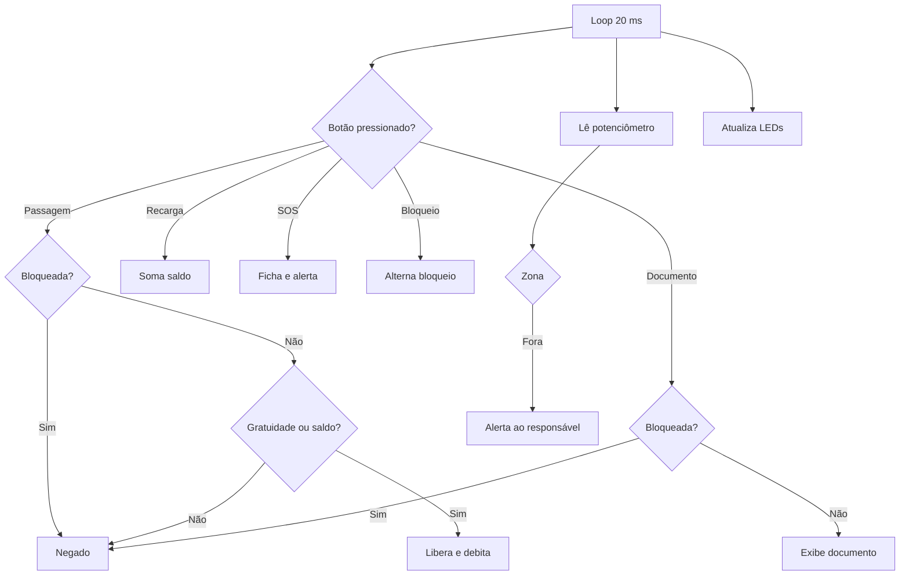

# Pulseira NFC Cidadã (nome provisório)

> **CitizenTech | Global Solution FIAP 2026.2** · Physical Computing: IoT & IoB · Computer Organization and Architecture (Prof. Dr. Marcus Grilo)
> Protótipo simulado no **Wokwi** com **Raspberry Pi Pico** e **MicroPython**.

| Integrante | RM |
|---|---|
| Arthur Primo Brandão | 573572 |
| Leandro Cavaccini Brito | 570556 |
| Lucas Dorice dos Santos | 568692 |

Ciência da Computação · FIAP

**Links de entrega**
- Projeto Wokwi: `https://wokwi.com/projects/480528004037520385`
- Vídeo (YouTube, não listado): https://youtu.be/8uLVGfoYNRM

---

## 1. Problema

Pessoas com deficiência física ou mental e idosos podem ter dificuldade de **carregar, enxergar, manusear e apresentar documentos**, de **pagar a passagem** e de **comprovar direito à gratuidade** no transporte público. Para a família, há ainda a dificuldade de **saber se a pessoa sob seus cuidados está em segurança**. Para qualquer cidadão, é incômodo carregar vários documentos e recarregar bilhetes.

**Quem é afetado**
- **Primário:** pessoas com deficiência e idosos com dificuldade de manuseio, visão ou mobilidade.
- **Secundário:** qualquer cidadão que queira reunir documentos e pagar o transporte com facilidade.
- **Rede de apoio:** responsáveis, familiares e cuidadores (com consentimento).

> `[INSERIR dados do IBGE sobre população com deficiência e idosos, após a pesquisa]`. Não incluímos números sem fonte.

**Por que tecnologia ajuda:** um único objeto, leve e sem bateria, que identifica a pessoa por aproximação, elimina a necessidade de manusear cartões e papéis e permite resposta rápida em emergências.

---

## 2. Solução

Uma **pulseira de silicone com chip NFC passivo** ligada a um aplicativo/site seguro.

| Função | O que faz |
|---|---|
| Documentos | Carteira digital protegida (RG, CPF, carteirinha de gratuidade, ficha de saúde). |
| Transporte | Saldo e passagem por aproximação, com liberação de gratuidade quando o direito está validado. |
| Rastreio com consentimento | Alerta ao responsável quando a pessoa sai de uma zona segura definida. |
| Emergência | Botão SOS e ficha de saúde para socorristas. |
| Bloqueio remoto | Invalida a pulseira em caso de perda ou roubo. |

**Princípio de segurança:** o chip **não guarda documentos**, apenas um **token**. Os dados ficam em servidor criptografado e o acesso exige autenticação.

---

## 3. O protótipo (o que foi construído)

O Wokwi não simula NFC nem GPS. Por isso, o protótipo representa o **cérebro da solução**: a Raspberry Pi Pico lê entradas, aplica regras e responde com atuadores.

| Mundo real | Componente no Wokwi | Pino |
|---|---|---|
| Toque da pulseira no validador | Botão **verde** | GP14 |
| Leitura de documento | Botão **azul** | GP13 |
| Recarga no app | Botão **amarelo** | GP12 |
| Emergência (SOS) | Botão **vermelho** | GP11 |
| Bloqueio remoto | Botão **preto** | GP10 |
| Distância da zona segura (GPS/BLE do celular) | **Potenciômetro** (0 a 500 m) | GP26 (ADC0) |
| Liberado / OK | LED **verde** + resistor 220 Ω | GP16 |
| Negado / bloqueada / alerta | LED **vermelho** + resistor 220 Ω | GP17 |
| Documento apresentado | LED **azul** + resistor 220 Ω | GP18 |
| Saldo baixo | LED **amarelo** + resistor 220 Ω | GP19 |
| Sinal sonoro | **Buzzer** (PWM) | GP20 |
| App / servidor / notificações | **Serial Monitor** | USB |

**Sem bibliotecas externas:** o código usa apenas `machine` (`Pin`, `ADC`, `PWM`) e `time`, nativos do MicroPython.

### Regras implementadas

| Evento | Resposta |
|---|---|
| Passagem com saldo suficiente | Debita tarifa (R$ 5,00, valor ilustrativo), LED verde, 2 bipes. |
| Passagem sem saldo | Negado: LED vermelho, bipe grave. |
| Passagem com gratuidade validada | Libera sem debitar (vale uma passagem). |
| Saldo abaixo de 2 tarifas | LED amarelo e aviso ao responsável. |
| Documento | Cicla RG → CPF → Cartão de Gratuidade → Ficha de Emergência. LED azul. |
| Pulseira bloqueada | Passagem e documentos negados; LED vermelho fixo. |
| SOS | Mostra a ficha de saúde, notifica o responsável, alarme. **Funciona mesmo bloqueada.** |
| Distância > 70 m | Aviso preventivo. |
| Distância > 100 m | Alerta "saiu da zona segura": LED vermelho piscando e alarme. |
| Retorno a menos de 90 m | Fim do alerta (histerese de 10 m evita falsos alertas na borda). |

### Fluxo da lógica

---

## 4. Como executar

### Roteiro de teste (1 minuto)

| # | Ação | Resultado esperado |
|---|---|---|
| 1 | Iniciar | Banner, LEDs piscam em sequência, saldo R$ 10,00 |
| 2 | Botão verde ×1 | Liberado, saldo R$ 5,00, LED amarelo acende |
| 3 | Botão verde ×2 | Liberado, saldo R$ 0,00 |
| 4 | Botão verde ×3 | **Negado** (saldo insuficiente) |
| 5 | Botão amarelo | Saldo R$ 10,00, LED amarelo apaga |
| 6 | Botão azul ×3 | RG, CPF, Cartão de Gratuidade (gratuidade validada) |
| 7 | Botão verde | Passagem **gratuita**, saldo mantido |
| 8 | Potenciômetro até ~85 m | Aviso preventivo |
| 9 | Potenciômetro até ~120 m | **Alerta** de saída da zona, LED vermelho piscando |
| 10 | Potenciômetro até ~50 m | Retorno à zona segura |
| 11 | Botão vermelho | SOS, ficha de saúde e alarme |
| 12 | Botão preto, depois verde | Pulseira bloqueada, passagem **negada** |
| 13 | Botão preto | Desbloqueio |

---

## 5. Da simulação à implementação real

| Protótipo | Versão real |
|---|---|
| Botão verde | Leitor NFC no validador (tags NTAG/MIFARE, sem bateria) |
| Potenciômetro | GPS/BLE do celular do usuário ou de um dispositivo complementar. **NFC sozinho não rastreia posição** (alcance curto e passivo). |
| Serial Monitor | Aplicativo/site + API + banco criptografado |
| Saldo em variável | Integração com bilhetagem das operadoras (ex.: Bilhete Único/SPTrans) `[a validar com pesquisa]` |
| Documentos simulados | Integração com meios oficiais (gov.br, CNH Digital, RG digital), sem substituí-los `[a validar com pesquisa]` |

**Decisão em aberto:** a tecnologia de localização (GPS no dispositivo, BLE ou celular) impacta custo, bateria e tamanho da pulseira.

---

## 6. Privacidade, LGPD e ética

- **Dados sensíveis:** documentos, localização e saúde de pessoas com deficiência exigem base legal, minimização e consentimento claro.
- **Menores e tutelados:** consentimento do responsável legal.
- **Rastreio sem vigilância:** consentimento, histórico de quem acessou, transparência e possibilidade de desativar.
- **Token no chip:** o chip não armazena dados pessoais.
- **Bloqueio remoto:** reduz o risco de uso indevido em caso de perda.
- **No protótipo:** nenhum dado real é usado. Documentos aparecem mascarados e a ficha de emergência é fictícia.

---

## 7. ODS

| ODS | Contribuição |
|---|---|
| **10**, Redução das desigualdades | Inclusão de pessoas com deficiência no acesso a serviços e mobilidade. |
| **11**, Cidades e comunidades sustentáveis | Transporte público mais acessível e inclusivo. |
| **3**, Saúde e bem-estar | Ficha de emergência e segurança de pessoas vulneráveis. |
| **9**, Indústria, inovação e infraestrutura | NFC/IoT aplicado a serviços públicos. |

`[Mapear as metas específicas de cada ODS após consulta ao site da ONU]`

**Sustentabilidade:** menos papel e plástico, silicone reutilizável e incentivo ao transporte coletivo.

---

## 8. Ecossistema

Cidadão usuário · responsáveis e cuidadores · operadoras de transporte · poder público (secretarias de transporte e de pessoas com deficiência) · organizações de apoio a PcD · serviços de emergência e saúde · equipe operadora da plataforma.

**Modelo de negócio:** quem paga a pulseira (cidadão, governo, convênio, empresa) `[A DEFINIR pelo grupo]`.

---

## 9. Limitações assumidas

- NFC, GPS e rede são **simulados** (limitação do Wokwi).
- A tarifa e os documentos são **ilustrativos**.
- Sem integração real com operadoras ou gov.br nesta etapa.

---

## 10. Checklist da entrega (critérios do professor)

| Critério | Peso | Onde atendemos |
|---|---|---|
| Problema social/urbano | 1,5 | Seção 1 e abertura do vídeo |
| Criatividade e relevância (CitizenTech) | 1,5 | Seções 2, 7 e 8 |
| Circuito correto no Wokwi | 2,0 | `diagram.json` e seção 3 |
| Programação MicroPython e lógica | 2,0 | `main.py` e tabela de regras |
| Demonstração e explicação no vídeo | 2,0 | `ROTEIRO_VIDEO.md` |
| Organização, links e identificação | 1,0 | Topo deste README |

- [x] Código MicroPython (`main.py`), sem bibliotecas externas
- [x] Circuito (`diagram.json`) com Pico, sensor, atuadores e entradas
- [x] README e roteiro do vídeo
- [x] Testar no Wokwi e salvar o projeto
- [x] Inserir o link do Wokwi acima
- [ ] Gravar e publicar o vídeo (YouTube, não listado) e inserir o link
- [x] Um único integrante envia os links e os três nomes completos